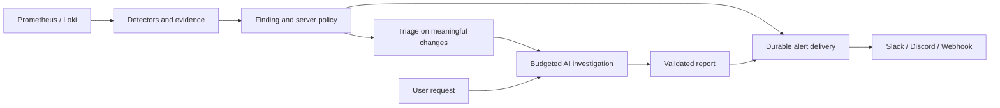

# Phase 2 implementation plan

Status: Slices A and B implemented and locally verified. Slice C now includes local recommendation rules and activity history; optional OpenAI/Anthropic advisory triage is implemented; opt-in automatic admission is implemented; Slice D bounded tools/follow-up is implemented; Slice E remains planned; actual provider and Slack/Discord smoke tests remain deployment checks. The active contract is [SPEC v1.2](../INFRA_SHERLOCK_CODEX_KIT/SPEC.md), especially Sections 14–20. The delivered [v1.1 baseline](../INFRA_SHERLOCK_CODEX_KIT/reference/v1.1/SPEC.md) is preserved unchanged.

The delivered workspace now groups configuration into dedicated Settings sections and separates investigation Report, AI analysis and Run activity views. Editors use focused drawers; the existing A/B workflows remain covered by browser regressions. See [interface direction](design/README.md) and [progress](progress.md).

## Intended first usable journey

Configure an OpenAI or Anthropic model and an allowed payload → connect a Slack, Discord, or generic destination → scan the demo → receive a factual finding notification → request AI analysis → inspect cited evidence and usage → enable bounded automatic triage/investigation once its behavior is understood.

Both AI providers and all three outbound destination types are in scope. OpenAI Decisions is an optional specialized triage adapter; Anthropic can provide the same application-level classification through structured output. No provider or model account access is assumed. Keep the existing deterministic path available at every milestone.

## What the code already gives us

| Current location | Reuse / required change |
| --- | --- |
| `internal/api/jobs.go` | River startup, transactional enqueue, snapshots, request budgets, lifecycle dedup. Add separate workers/queues and domain events; do not put paid calls in the existing scan transaction. |
| `internal/connectors/collect.go` | Bounded collectors, coverage, redaction, stable fingerprints. Reuse approved query templates; add a compact model-facing evidence builder. |
| `internal/investigations/report.go` | Deterministic fallback and evidence scope validation. Reuse provenance checks and add typed AI report validation. |
| `internal/api/sources.go` | Scoped configuration and source/service checks. Apply those patterns to new resources without mixing provider credentials with telemetry selectors. |
| `internal/crypto/` and `internal/maintenance/rotate.go` | Record-bound encryption and rotation. Rotation covers connection and notification destination secrets; extend it with provider credentials in Slice B. |
| `migrations/003_runs.sql` | Existing runs permit scan/investigation kinds; progress has unique `(run_id, stage)`. Use linked AI run/step tables for repeated steps; preserve existing report/event contracts. |
| `web/src/pages/Sources.tsx`, `Investigations.tsx`, `Workspace.tsx` | Extend current settings, report, and finding workflows. Keep setup/demo usable without external credentials. |

Use new forward migrations. Preserve findings' current dedup identity and lifecycle state. Do not change model configuration into a signal-mapping revision change.

## Slice A — Durable events and outbound notifications

Deliver Slack, Discord, and signed generic webhook destinations with encrypted secret storage, scoped API/UI, preview/test send, routing filters, and delivery history. Add notification events/outbox and a River delivery queue. Commit events with finding/report/lifecycle changes; only new or explicitly meaningful events qualify.

Implement safe HTTP dispatch, payload formatting and limits, quiet hours with an explicit IANA timezone, grouping, retry/backoff, rate-limit responses, pending-job cancellation, expiry, and unknown-outcome reporting. Include stable event IDs. Generic signatures cover exact bytes; Discord requests acknowledgement; Slack delivery remains new-message-only. A localhost app URL should produce a useful configuration warning for remote recipients.

Extend rotation, backup/restore, and secret-deletion tests for destination URLs and signing keys in this slice, not at the end of Phase 2.

Acceptance:

- Replaying or concurrently processing one domain event creates one logical delivery; lost acknowledgements are handled as potentially duplicated external sends.
- A database rollback queues no alert; restart recovers pending deliveries.
- 429/retryable failures respect bounded retry policy; invalid credentials visibly fail without exposing URLs/tokens.
- Disabled destinations, snoozed findings, quiet hours, expired content, and demo-origin filters are enforced at dispatch.
- Platform payloads cannot generate unintended mentions from log/user text.
- Playwright configures a fixture destination, previews a message, triggers a demo scan, and displays sent/failed/retrying outcomes.

Result: useful external alerts before AI credentials are configured.

## Slice B — Provider settings, usage admission, and reactive AI reports

Add encrypted OpenAI/Anthropic configurations, explicit egress settings, separate role/model selections, synthetic capability tests, a provider-independent typed result, invocation records, and transactional budget reservations. Configure separate AI workers. First support one structured analysis of an existing investigation's bounded evidence; keep tool exploration and automatic triggers out of this slice.

Show **Investigate with AI**, provider/model and expected payload, progress/cancellation, actual usage, and the resulting AI analysis beside the deterministic report. Handle provider refusals, truncation, unsupported schemas/models, overload, timeouts, and errors explicitly. Persist no hidden reasoning. Add output redaction and TTL cleanup for generated text/cache/conversation material.

Acceptance:

- Either provider can produce the same validated report contract from fixtures; invalid/cross-scope/expired citations yield an evidence-only fallback.
- No provider request occurs before workspace/service opt-in or after disablement at dispatch.
- Concurrent workers cannot spend the same reservation balance; retries and ambiguous timeouts preserve accounting.
- Provider failure leaves scans, factual alerts, and deterministic reports working.
- Encryption rotation/restore includes provider credentials as well as destination secrets.
- Playwright covers provider setup, payload preview, AI report, cancel, failure/fallback, and budget exhausted.

Result: a useful reactive AI feature with measurable cost and a no-AI fallback.

Delivered scope: one investigation model per provider; triage-role selection belongs to Slice C. Each AI run is its single invocation/reservation record; repeated steps belong to Slice D. One paid attempt, 12,000 estimated input / 2,048 output tokens, and a 180-second deadline from enqueue. No tool calls or automatic triggers. See [AI setup and accounting](ai.md) and [verification](progress.md).

## Slice C — Decision adapters and proactive triage

Delivered first increment, per the user's recommendation-first choice: **Off / Recommendations only** settings, explicit service/demo selection, deterministic material-change rules, durable 60-second service grouping, recommendation cooldowns, and paginated activity with per-finding reasons. This increment never starts investigations or calls models. Defaults are Off, no selected services, demo excluded, 30-minute cooldown and 2× growth plus the detector's absolute minimum. Settings revisions reset comparison baselines without replaying a backlog. See [automation setup and rules](automation.md).

Delivered second increment: optional OpenAI Responses/Anthropic Messages triage with a separate configured/tested model role, explicit recurring consent, shared budget reservations, bounded structured decisions, scoped result reuse, cancellation and per-activity AI advice. Local rules and factual alerts stay independent; investigations remain manual in Recommendations only mode. See [automation operations](automation.md).

Delivered third increment: opt-in automatic admission with explicit recurring consent and a separately tested investigation provider. Durable admission waits for optional triage, applies server policy, then atomically builds a deterministic report from triggering evidence and reserves/enqueues Slice B analysis. Activity exposes launched/skipped reasons, links, accounting and cancellation. Scope/privacy/lifecycle/recovery checks apply before dispatch and publication; defaults remain Off. See automation operations and progress for actual verification.

Remaining Slice C work includes the optional OpenAI Decisions endpoint and live usefulness evaluation; full Slice C is not complete.

Review fixes in the local-rules increment: complete healthy scans invalidate pending signals, freshness is bounded by the actual observation as well as batch age, current Monitoring settings are rechecked at evaluation, and finding history links ignore retained list filters/cursors. Recovery skips preserve evidence and do not consume cooldowns. Forward migration 008 records recovery timestamps.

Advisory triage review fixes include shared workspace scope guards before service/rule locks and AI accounting at admission, dispatch and publication. Concurrent mapping edits and accounting writes must complete without deadlocks; the same lock order applies to automatic admission. Actual regression results are recorded in [progress](progress.md). Automatic-admission review adds durable late cancellation, atomic cancellation on policy saves, and serialized linked-history deletion across replicas. Forward migration 011 preserves cancellation intent; defaults remain Off. Completed automatic reports can also satisfy equivalent manual analysis requests without another paid call; explicit fresh requests and all cache/privacy checks remain enforced.

Implement deterministic routing plus optional OpenAI Decisions and structured classification through OpenAI/Anthropic. Normalize only supported answer types; map refusal/incomplete/error to rules fallback. Record model recommendation separately from the server's applied action/reason.

Add durable automation events from finding changes, the 60-second coalescing gate, material-change measurements, persisted cooldowns, strict content/version cache keys, and off/triage-only/auto-investigate modes. Auto-investigate invokes Slice B's bounded analysis initially; triage itself has no tools. Notification policy remains independent and cannot be overridden by a model's `observe` recommendation.

Acceptance:

- Repeated unchanged scans generate no extra model calls; a new occurrence or qualifying change triggers one eligible task.
- Restart, concurrent event delivery, and mapping changes preserve deduplication/cooldown boundaries.
- Snooze/dismissal, monitoring disable, privacy revocation, and budget exhaustion stop future automatic dispatch.
- A policy-mandated alert is delivered despite model refusal, outage, or an `observe` answer.
- UI explains both launched and skipped work without presenting model confidence as outage probability.

Result: proactive investigations with explicit controls for cost and noise.

## Slice D — Bounded investigation tools and follow-up

Implemented: explicit tool consent, approved mapped evidence/Prometheus/Loki collection, durable ordered step execution, cumulative budgets, no uncertain paid replay, scoped follow-up, privacy cleanup and UI progress. Automatic tools require additional opt-in and default false. See [AI operations](ai.md#bounded-tools-and-scoped-follow-up-slice-d) for exact limits and [progress](progress.md) for actual verification. Live provider validation is deferred by the user.

Add the approved read-only evidence/Prometheus/Loki tools, persisted multi-step execution, ordered progress, cancellation between calls, and typed hypotheses with supporting and contradicting evidence. Run every tool through the existing source/network/query controls. Reserve cumulative tokens, tool requests, telemetry attempts, cost, and wall time before each step.

Add report follow-up with a bounded transcript and expiry. A follow-up requiring fresh collection starts a linked bounded run; wider scope starts a new investigation. Model requests cannot select a destination or call arbitrary network/shell/query tools.

Acceptance:

- Malicious log instructions cannot widen service/time scope, disclose secrets, change tools, or send a message.
- Accepted provider/tool results survive restart without unbounded paid-call replay.
- Every exit path preserves progress, a clear terminal reason, and the deterministic fallback.
- New AI step sequencing does not break the existing completion/cancellation event regression tests.
- Scenario evaluations distinguish evidence-backed symptoms from unsupported causes and test contradictory/insufficient data.

Result: deeper reactive and proactive investigations using the same bounded engine.

## Slice E — Authenticated inbound alert triggers

Implement the separate signed generic alert endpoint and administrator-managed service bindings, receipt IDs, signature timestamp/replay checks, payload/rate limits, time-window validation, and asynchronous enqueue. Bindings determine workspace/service/policy; inbound data supplies context only. Do not accept an outbound notification envelope back as a new incident.

Acceptance:

- Duplicate verified events reuse the receipt; conflicting IDs, stale signatures, wrong secrets, disabled bindings, and unsupported windows are rejected explicitly.
- Valid events trigger the same bounded policy and investigation path as manual/proactive work.
- Receipt/job insertion is atomic and survives restart.
- Documentation includes an exact signing example and distinguishes this generic schema from native Alertmanager or Slack/Discord bot APIs.

Result: external monitoring tools can request reactive investigations without a chat bot.

## Verification and rollout gates

Run focused unit/contract tests during each slice, then the existing Go race, PostgreSQL, browser, and real-source checks at a milestone that changes their paths. Keep deterministic fixture tests reproducible and distinguish them from actual cloud calls. Add fault tests for outages, retries, restart, missing data, and revoked configuration.

Before enabling unattended AI in a deployment, evaluate a fixed, versioned scenario set and record factual errors, useful-report rate, triage misses, cost per run, and latency. Start in triage-only mode to compare recommendations with actual operator decisions. No claimed accuracy or default “best model” until measurements exist. Model and price changes rerun capability checks and relevant evaluations.

Live provider and destination smoke tests require credentials and a user-selected test channel/receiver; they remain a deployment/release gate beyond local fixture verification. Clearly label test sends and their purpose. Do not silently use production channels to verify delivery.

Proposed defaults are specified in the active spec and adjustable within server-enforced limits. Actual daily budget, provider/model choices, and destination credentials are supplied during setup. These missing deployment choices do not block writing adapters and fixture tests once implementation is authorized.

## Completion checklist

Slice B review fixes cover stale provider previews, access to older unresolved charges, and identical admitted/dispatched payload bytes; verification is recorded in [progress](progress.md).

- [x] A: outbound destinations, durable delivery, and secret lifecycle verified with local fixtures.
- [x] B: both providers, reactive structured reports, privacy, and budgets verified with local fixtures.
- [x] C, first increment: local recommendations, durable rules/cooldowns and activity history.
- [x] C, second increment: OpenAI/Anthropic advisory triage, scoped reuse, budget admission and fixture scenarios.
- [x] C, third increment: opt-in automatic investigation admission using bounded existing-evidence analysis.
- [ ] C, remaining: optional Decisions endpoint and live usefulness evaluation.
- [x] D: tool loop, restart safety, versioned fixture evaluations, and follow-up implemented; verification recorded in progress.
- [ ] E: signed inbound trigger pipeline verified.
- [x] Existing deterministic demo and all prior regression cases still pass.
- [ ] Actual provider and notification smoke tests documented, with failures/limits stated.

Mark a slice complete only after recording its local checks in progress; actual platform credentials remain a separate live smoke-test gate.
